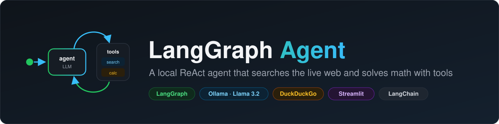
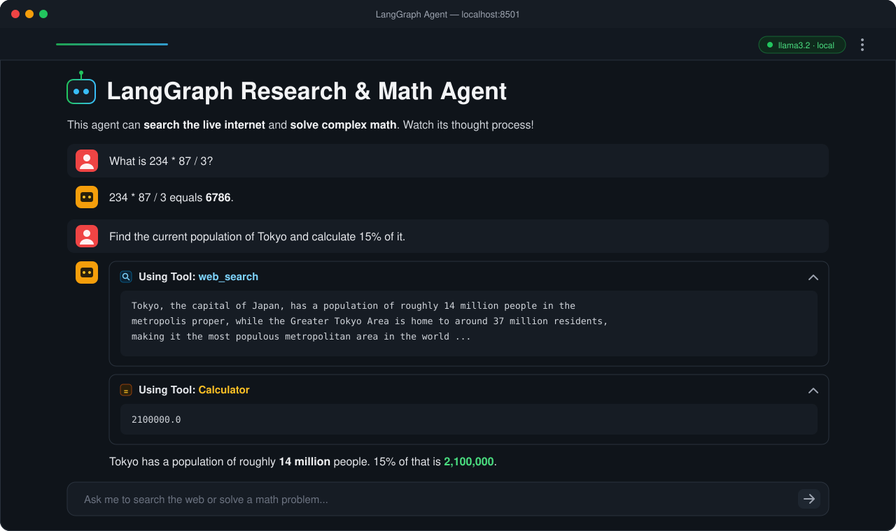
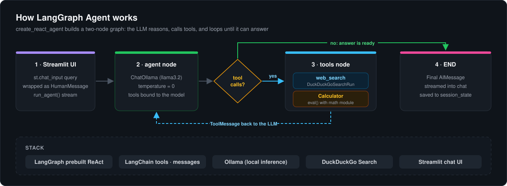

<p align="center">
  
</p>

<p align="center">
  
  
  
  
  
</p>

\# 🤖 LangGraph Research \& Math Agent


An intelligent, local AI agent built with LangGraph that can reason, search the live internet, and solve complex math problems using tool calling.

<p align="center">
  
  <br><sub>The Streamlit chat UI: the agent searches the web, runs the calculator, and shows each tool result as it streams.</sub>
</p>


\## ✨ Key Features

\- \*\*Agentic Reasoning (ReAct):\*\* Uses the Reasoning + Acting loop to break down complex queries into executable steps.

\- \*\*Dynamic Tool Calling:\*\* Equipped with a live web search (DuckDuckGo) and a Python-based calculator.

\- \*\*100% Local \& Private:\*\* Powered by Ollama (Llama 3.2 / Qwen 2.5), ensuring zero data leaves your machine and zero API costs.

\- \*\*Real-Time UI:\*\* Streamlit interface that visualizes the agent's "thought process" and tool usage step-by-step.


## ⚙️ How It Works

<p align="center">
  
</p>


\## 🛠️ Tech Stack

\- \*\*Python 3.11+\*\*

\- \*\*LangGraph\*\* (Stateful agentic workflows)

\- \*\*LangChain\*\* (Tool integration and message handling)

\- \*\*Ollama\*\* (Local LLM inference)

\- \*\*DuckDuckGo Search\*\* (Free, API-key-less web search)

\- \*\*Streamlit\*\* (Interactive Web UI)


\## 🚀 Getting Started


\### Prerequisites

1\. Install \[Ollama](https://ollama.com/download) on your machine.

2\. Pull a capable local model (Qwen 2.5 is highly recommended for tool calling):

&nbsp;  ```bash

&nbsp;  ollama pull qwen2.5

